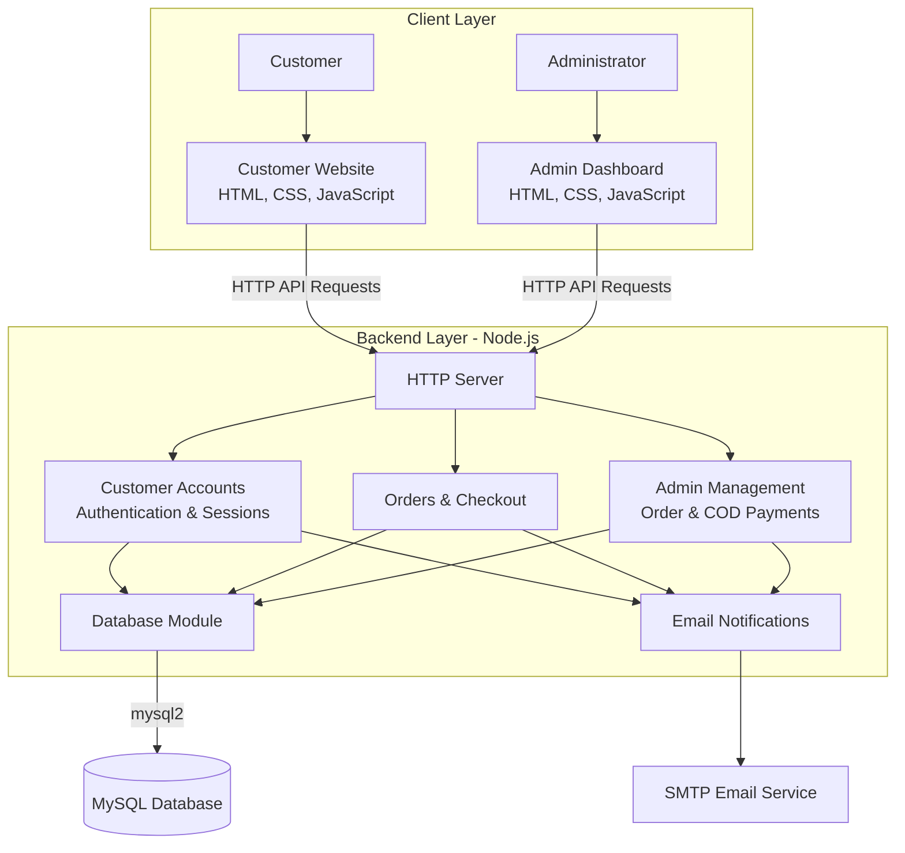
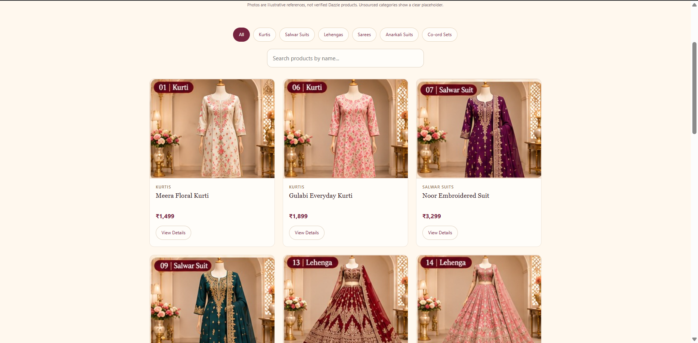
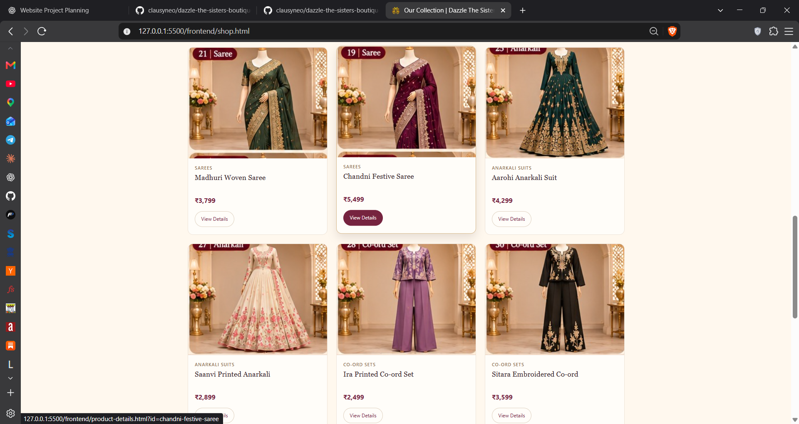
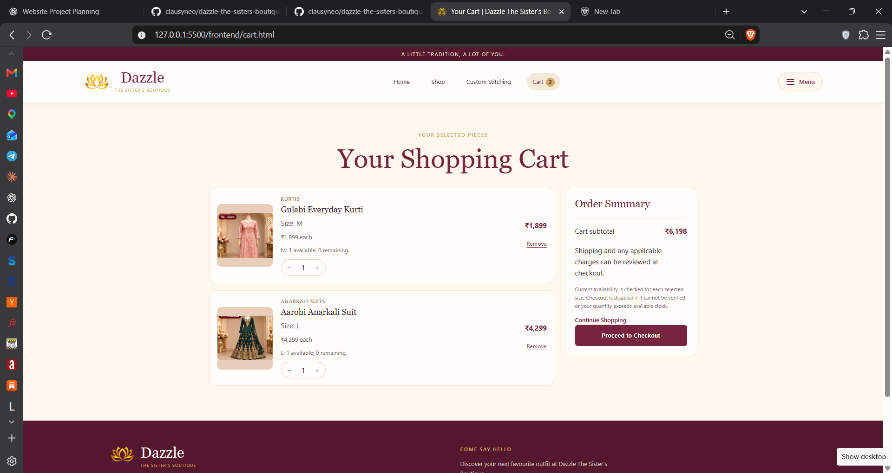
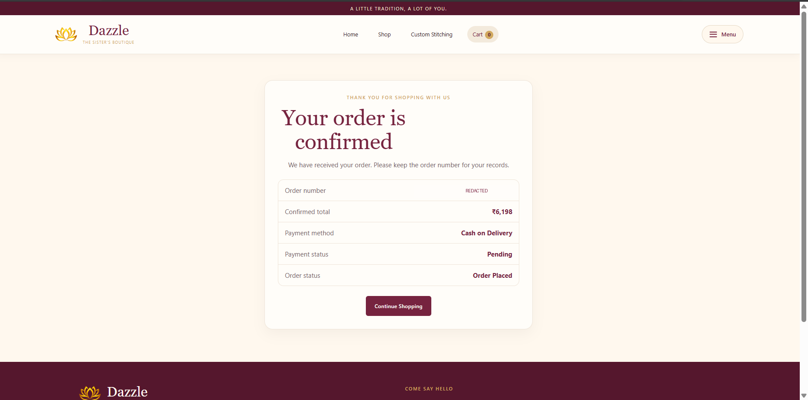
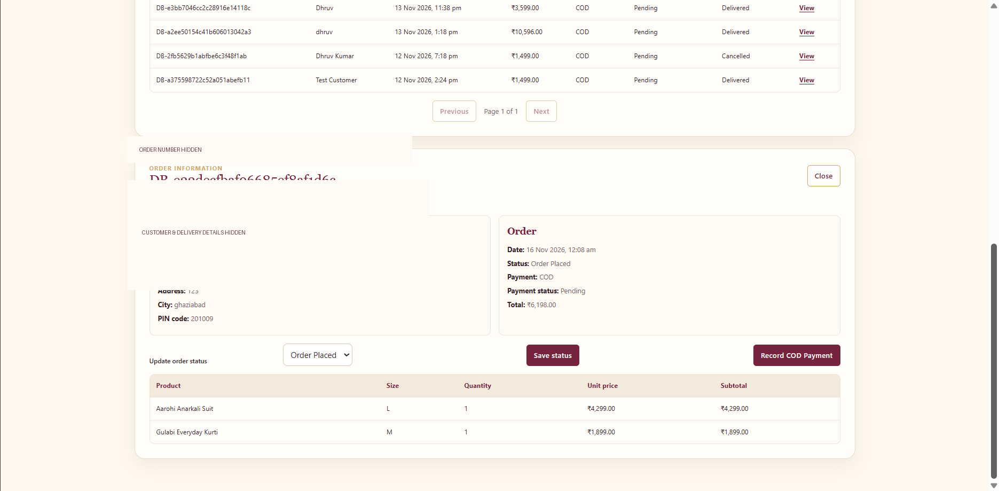

# Dazzle the Sister's Boutique

A full-stack e-commerce website developed as a BCA Minor Project for a women's ethnic wear boutique.

**Repository:** [dazzle-the-sisters-boutique](https://github.com/clausyneo/dazzle-the-sisters-boutique)

## Project Overview

Dazzle the Sister's Boutique is an online shopping platform for women's ethnic wear. It provides a customer storefront and a separate admin dashboard for managing orders and COD payments.

## Features

### Customer
- Registration, login and profile management
- Product catalogue and product details
- Shopping cart and checkout
- Cash on Delivery (COD)
- Order history and order tracking
- Email notifications
- Password recovery

### Administration
- Secure admin authentication
- Order management dashboard
- Order status management
- Customer order details
- COD payment recording
- Payment status tracking

## Technology Stack

| Layer | Technology |
|---|---|
| Frontend | HTML, CSS, JavaScript |
| Backend | Node.js |
| Server | Node.js HTTP server |
| Database | MySQL |
| Database driver | mysql2 |
| Version control | Git and GitHub |


## Project Structure

```text
dazzle-the-sisters-boutique/
├── backend/
│   ├── accounts.js
│   ├── accounts.test.js
│   ├── admin.js
│   ├── admin.test.js
│   ├── create-admin.js
│   ├── database.js
│   ├── email.js
│   ├── email.test.js
│   ├── orders.js
│   ├── orders.test.js
│   ├── reset-admin-password.js
│   └── server.js
│
├── database/
│   ├── migrations/
│   ├── checkout_schema.sql
│   ├── dazzle_boutique.sql
│   ├── seed_demo_product_size_stock.sql
│   └── seed_existing_product_size_stock.sql
│
├── docs/
│   └── screenshots/
│
├── frontend/
│   ├── assets/
│   │   └── images/
│   ├── css/
│   │   └── style.css
│   ├── js/
│   │   ├── admin.js
│   │   └── main.js
│   └── ├── account-login.html
├── account-register.html
├── admin-dashboard.html
├── admin-login.html
├── cart.html
├── checkout.html
├── forgot-password.html
├── index.html
├── my-account.html
├── order-confirmation.html
├── order-tracking.html
├── product-details.html
├── reset-password.html
└── shop.html
│
├── .env.example
├── .gitignore
├── package.json
├── package-lock.json
└── README.md
```

## System Architecture



## Getting Started

### Prerequisites
- Node.js
- npm
- MySQL Server
- Visual Studio Code (recommended)
- Live Server extension for frontend development

### 1. Clone the repository

```bash
git clone https://github.com/clausyneo/dazzle-the-sisters-boutique.git
cd dazzle-the-sisters-boutique
```

### 2. Install dependencies

```bash
npm install
```

### 3. Configure environment variables

Create a local `.env` file by copying `.env.example`.

On Windows PowerShell:

```powershell
Copy-Item .env.example .env
```

Update the values in `.env` with your local MySQL and SMTP configuration.

Never upload your actual `.env` file or share credentials publicly.

### 4. Configure the database

Create the `dazzle_boutique` database and execute the SQL setup files and migrations in the required order.

The database directory contains the schema, migrations and product stock seed scripts. Review each script before executing it against an existing database.

### 5. Start the backend

```bash
npm start
```

The backend uses the configuration in `.env`.

### 6. Start the frontend

Open `frontend/index.html` using the VS Code Live Server extension.

The default frontend URL configured in the example environment is:

```text
http://127.0.0.1:5500/frontend/
```

## Testing

Run automated tests:

```bash
npm test
```

Run JavaScript syntax checks:

```bash
npm run check
```

## Project Scope

The minor project focuses on readymade product shopping, customer accounts, COD checkout, order tracking, email notifications and basic administration.

Advanced boutique operations such as custom stitching management, digital measurement records, advanced inventory management and labour management are reserved for future development.

## Testing Status

The project has passed 94 automated tests and manual end-to-end testing of its core customer, order-management and COD payment workflows.

## Academic Information

- **Degree:** Bachelor of Computer Applications (BCA)
- **Project:** Dazzle the Sister's Boutique
- **Project Type:** Minor Project

---

Developed for academic and practical learning purposes.
## Screenshots

### Customer Website











### Admin Panel



