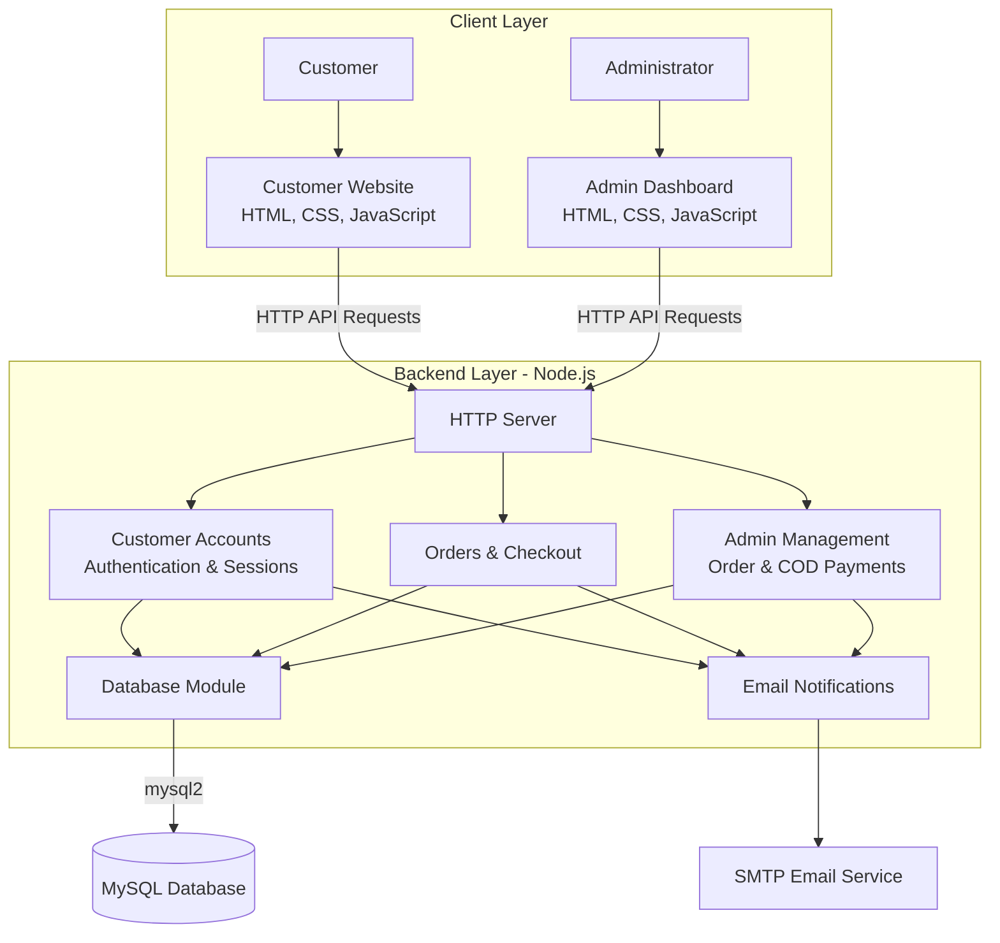
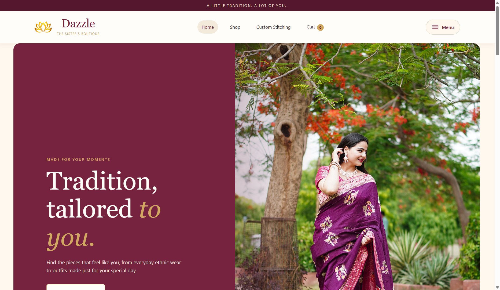
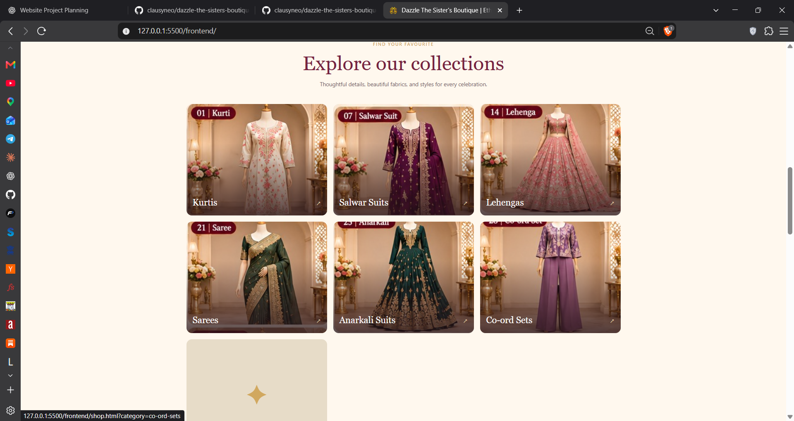
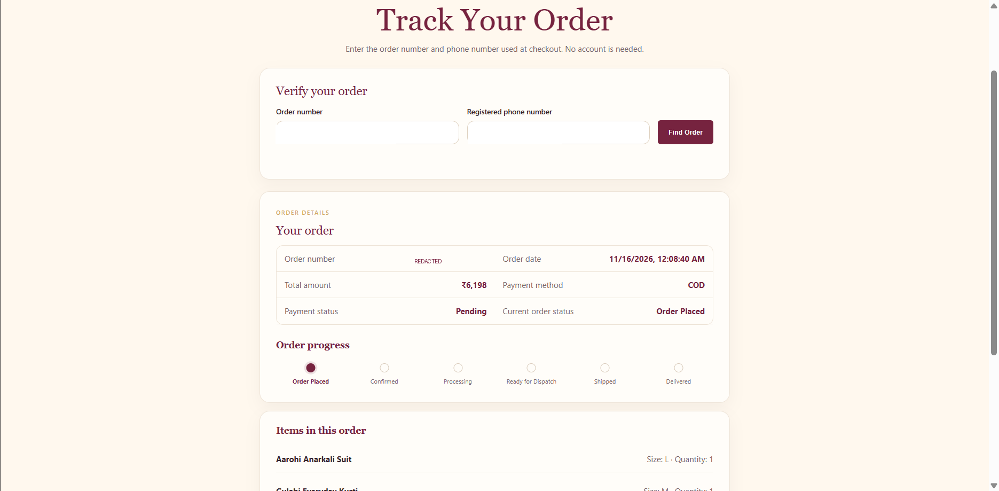
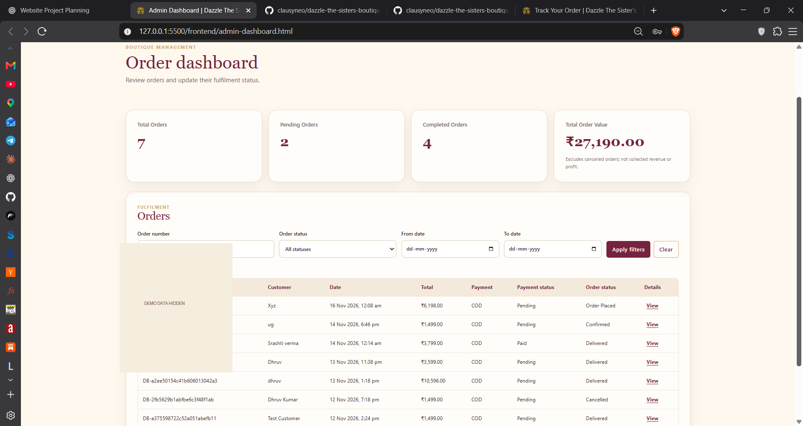

# Dazzle the Sister's Boutique

A full-stack e-commerce website developed as a BCA Minor Project for a women's ethnic wear boutique.

**Repository:** [dazzle-the-sisters-boutique](https://github.com/clausyneo/dazzle-the-sisters-boutique)

## Project Overview

Dazzle the Sister's Boutique is an online shopping platform for women's ethnic wear. It provides a customer storefront and a separate admin dashboard for managing orders and COD payments.

## Features

### Customer
- Registration, login and profile management
- Product catalogue and product details
- Shopping cart and checkout
- Cash on Delivery (COD)
- Order history and order tracking
- Email notifications
- Password recovery

### Administration
- Secure admin authentication
- Order management dashboard
- Order status management
- Customer order details
- COD payment recording
- Payment status tracking

### Royal Measurement Studio
- Authenticated customer APIs for measurement profiles across supported garment categories
- Measurement values stored in centimetres with a customer-selected display unit
- Backend-defined field ranges are served by `GET /api/measurement-rules` for both measurement editors
- Customer Measurement Book with create, view, edit and delete journeys
- Admin search, view and edit tools for customer measurement profiles

## Technology Stack

| Layer | Technology |
|---|---|
| Frontend | HTML, CSS, JavaScript |
| Backend | Node.js |
| Server | Node.js HTTP server |
| Database | MySQL |
| Database driver | mysql2 |
| Version control | Git and GitHub |


## Project Structure

backend/ - Node API and tests
database/ - schema, seeds, and migrations
frontend/ - static storefront, account/admin pages, and assets
render.yaml - Render backend and static-site Blueprint

## System Architecture



## Getting Started

### Prerequisites
- Node.js
- npm
- MySQL Server
- Visual Studio Code (recommended)
- Live Server extension for frontend development

### 1. Clone the repository

```bash
git clone https://github.com/clausyneo/dazzle-the-sisters-boutique.git
cd dazzle-the-sisters-boutique
```

### 2. Install dependencies

```bash
npm install
```

### 3. Configure environment variables

Create a local `.env` file by copying `.env.example`.

On Windows PowerShell:

```powershell
Copy-Item .env.example .env
```

Update the values in `.env` with your local MySQL and SMTP configuration.

Never upload your actual `.env` file or share credentials publicly.

### 4. Configure the database

Create the `dazzle_boutique` database and execute the SQL setup files and migrations in the required order.

The database directory contains the schema, migrations and product stock seed scripts. Review each script before executing it against an existing database.

The customer measurement profile migration is additive and depends on the active
`customers` table. Review
[`database/migrations/README.md`](database/migrations/README.md) before applying
it. It has not been run against the production database.

### 5. Start the backend

```bash
npm start
```

The backend reads process environment variables. For local development, load
your ignored `.env` file in your shell or use `node --env-file=.env
backend/server.js` directly. The Render start command is `npm start`; it does
not require an `.env` file.

## Render deployment

The root `render.yaml` describes a Node web service and a static site publishing
the `frontend` directory. The backend health check uses `/api/status`. The
Blueprint sets automatic deployment off; review service names and settings in
Render before applying it. A Blueprint file does not perform a deployment by
itself.

Set these backend environment variable names in Render (enter values in the
Render dashboard, never in Git):

- Required database settings: `DB_HOST`, `DB_PORT`, `DB_USER`, `DB_PASSWORD`,
  `DB_NAME`, and `DB_SSL_CA_PATH`.
- Set `NODE_ENV` to `production`; Render supplies `PORT`.
- Set `FRONTEND_ORIGIN` and `ADMIN_FRONTEND_ORIGIN` to the deployed browser
  origin or origins. Multiple comma-separated origins are supported.
- Set `FRONTEND_BASE_URL` to the public frontend URL for password reset links.
- Email is optional; use `BREVO_API_KEY`, `BREVO_SENDER_EMAIL`, and
  `BREVO_SENDER_NAME` for Brevo, or `SMTP_HOST`, `SMTP_PORT`,
  `SMTP_USERNAME`, `SMTP_PASSWORD`, and `SMTP_FROM` for SMTP.

Upload the database CA certificate as a Render secret file named
`tidb-ca.pem`; the Blueprint points `DB_SSL_CA_PATH` at
`/etc/secrets/tidb-ca.pem`. Do not add the certificate to the repository.
`frontend/js/config.js` uses localhost for local development and the configured
production API origin for public hosts. Update that public origin if the
backend service URL changes.

## Measurement profile API

Customer routes require the existing customer session cookie and always scope
profile access to the signed-in customer:

The public `GET /api/measurement-rules` endpoint exposes the same category and
field limits enforced by the backend, so customer and admin input constraints
do not maintain separate copies of the ranges.

| Method | Route | Purpose |
|---|---|---|
| `GET` | `/api/account/measurement-profiles` | List the signed-in customer's profiles |
| `POST` | `/api/account/measurement-profiles` | Create a profile |
| `GET` | `/api/account/measurement-profiles/:profileId` | View one owned profile |
| `PATCH` | `/api/account/measurement-profiles/:profileId` | Edit one owned profile |
| `DELETE` | `/api/account/measurement-profiles/:profileId` | Delete one owned profile |

Admin routes require the existing admin session. The list supports `search`,
`garmentCategory`, `page`, and `pageSize`; admins can also view and edit one
profile:

| Method | Route | Purpose |
|---|---|---|
| `GET` | `/api/admin/measurement-profiles` | Search and list profiles |
| `GET` | `/api/admin/measurement-profiles/:profileId` | View a profile |
| `PATCH` | `/api/admin/measurement-profiles/:profileId` | Edit a profile |

Supported category codes are `BLOUSE`, `SUIT_SALWAR_KAMEEZ`, `LEHENGA`,
`KURTI`, `PANTS_PALAZZO`, and `ANARKALI_GOWN`. Measurement values are
validated per category and stored in centimetres; responses use each
profile's `unitPreference`. The configured field limits are broad sanity
checks, not universal tailoring standards. Shoulder, armhole, waistband
position, length endpoints, and ankle-opening definitions depend on boutique
practice. Existing values outside the current ranges remain readable and are
retained by metadata-only or unit-only edits. A measurement is range-checked
when it is created or changed. Each customer can save up to 20 profiles. In a
`PATCH` request, supplied measurement fields are merged into the existing set;
omitted fields are preserved. See
[`database/migrations/README.md`](database/migrations/README.md) before
applying the additive schema migration.

### 6. Start the frontend

Open `frontend/index.html` using the VS Code Live Server extension.

The default frontend URL configured in the example environment is:

```text
http://127.0.0.1:5500/frontend/
```

## Testing

Run automated tests:

```bash
npm test
```

Run JavaScript syntax checks:

```bash
npm run check
```

### Isolated measurement integration tests

The real HTTP integration harness is opt-in and uses `.env.test` only. Node.js
20.12 or newer is required. Configure these keys in the ignored `.env.test`
file: `DB_HOST`, `DB_PORT`, `DB_USER`, `DB_PASSWORD`, `DB_NAME`, and
`DB_SSL_CA_PATH`. The harness accepts only the approved TiDB test host on port
`4000` and database `dazzle_boutique_test`; it requires TiDB v8.5.3 or newer,
pessimistic global and session transaction modes, and a valid CA certificate
with server identity verification enabled.

Apply and verify the customer, session, admin, and measurement schemas in the
isolated test database before running the harness. It never creates or alters
tables. Before writing, it requires exactly the six expected integration
tables and verifies that all are empty; it stops if tables are missing,
unexpected tables exist, or any rows are present. Tests use random synthetic
identities, run the API on `127.0.0.1`, and remove their rows through customer
and admin foreign-key cascades. Cleanup checks all six tables and causes a
non-zero exit if any rows remain.

Run the integration suite with:

```bash
npm run test:integration
```

The harness does not use `.env`, does not run migrations, and never prints
credentials, passwords, session cookies, or tokens. Do not run it against a
database containing data you need to preserve.

### Royal Measurement Studio browser tests

The Playwright browser harness uses the same `.env.test`-only safety checks and
the approved, empty `dazzle_boutique_test` database. Install project packages
and Chromium once:

```bash
npm install
npx playwright install chromium
```

Then run the desktop/mobile browser journeys:

```bash
npm run test:browser
```

The harness verifies the database host, database name, TiDB version,
pessimistic transaction modes, TLS CA and server identity before creating any
test data. It requires the six integration tables to match the test schema and
be empty. The customer and admin APIs use the real local backend and database;
only unrelated admin order-dashboard requests are stubbed. Both web servers
bind to loopback, the browser blocks non-local requests, and the test frontend
configuration points only to the loopback API. Synthetic customer/admin data
is removed in a `finally` cleanup and all six tables are checked afterward.
The test prints no credentials, passwords, cookies or tokens. Failure
screenshots are saved under the ignored `test-results/` directory.

## Project Scope

The minor project focuses on readymade product shopping, customer accounts, COD checkout, order tracking, email notifications and basic administration.

Advanced boutique operations such as custom stitching management, advanced inventory management and labour management are reserved for future development. Customer measurement profiles are implemented in the Royal Measurement Studio described above.

## Testing Status

The prior baseline recorded 94 automated tests and manual end-to-end testing of core customer, order-management and COD workflows. The current feature branch adds measurement unit tests; see the current test run results before publication.

## Academic Information

- **Degree:** Bachelor of Computer Applications (BCA)
- **Project:** Dazzle the Sister's Boutique
- **Project Type:** Minor Project

---

Developed for academic and practical learning purposes.
## Screenshots

### Customer Website








### Admin Panel




